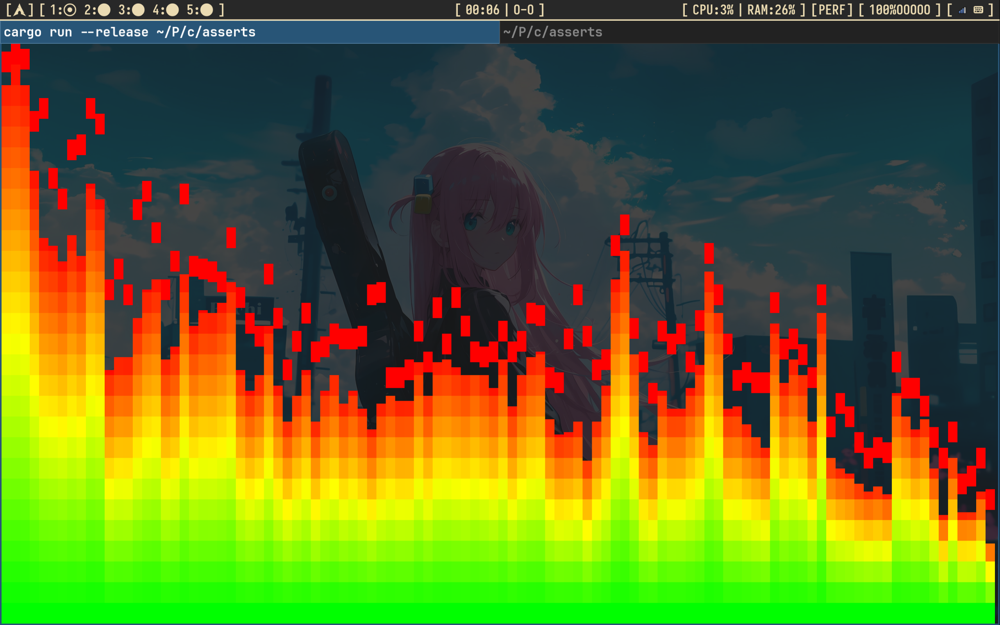
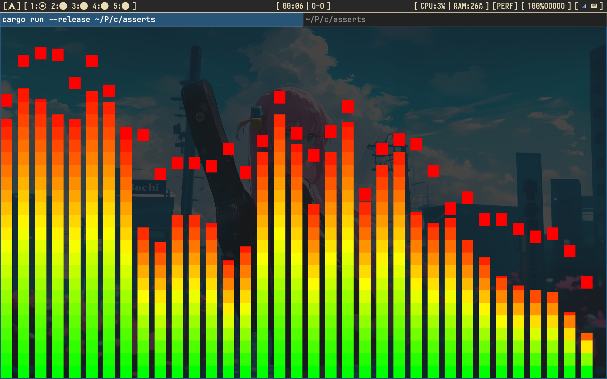
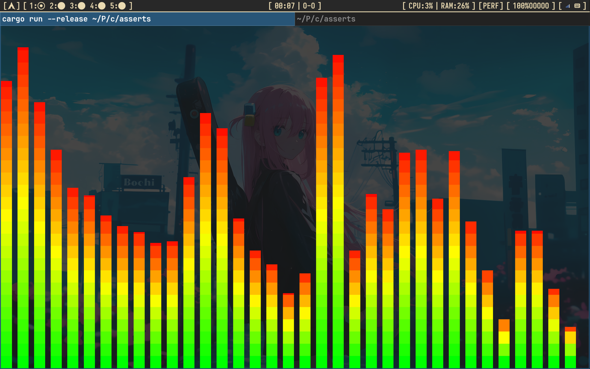
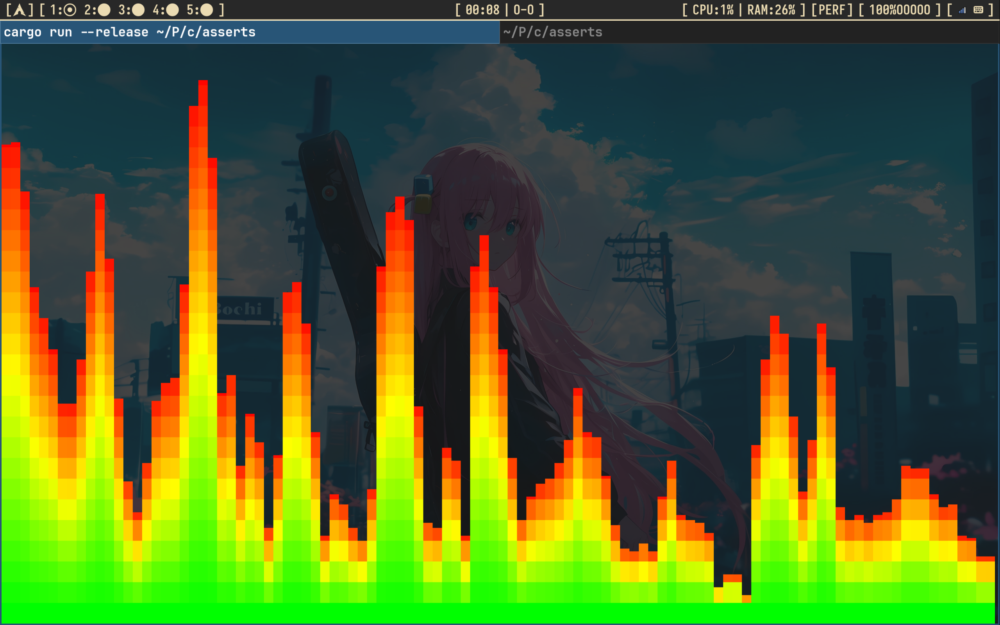

# cava_plus_plus

A small terminal audio spectrum visualizer in Rust. It is like [cava](https://github.com/karlstav/cava).

> **NOTE:** This is a toy project. It is not finished. Many features are missing. Use it for fun and learning only.

## Demo

mini_cava can show 4 display modes. The 4 videos below show each mode.

You can only change the mode by editing the `const` values in `src/main.rs` and rebuilding. There is no runtime switch yet.

### Mode 1



### Mode 2



### Mode 3



### Mode 4



## Environment

This project was only tested on:

- Arch Linux
- PipeWire (only, no PulseAudio or JACK)

It reads audio from the PipeWire `default_sink` monitor. It may not work on other systems.

## Dependencies

- Rust (nightly, edition 2024)
- System libraries: `pkgconf`, `pipewire`, `alsa-lib`, `clang`

Install on Arch Linux:

```sh
./install_deps.sh
```

## Build and run

```sh
cargo run
```

Press `q` to quit.

